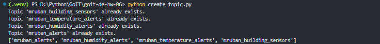
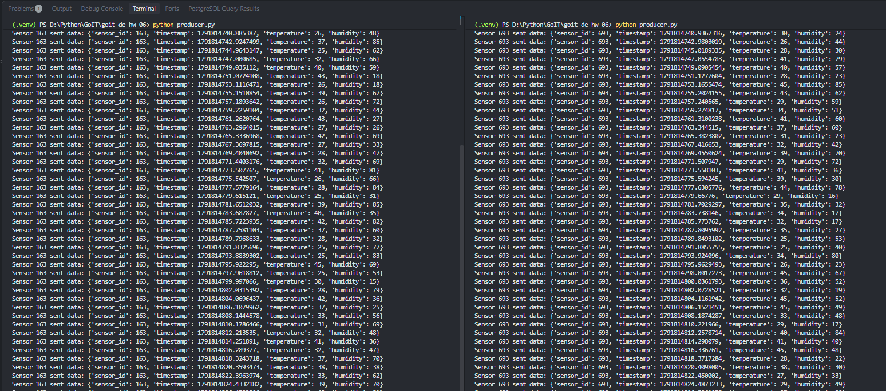
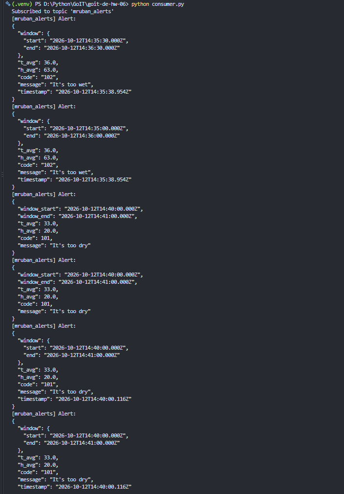

# goit-de-hw-06 — Spark Structured Streaming + Kafka

Домашнє завдання до теми «Spark streaming».

Потік даних сенсорів (`producer.py`) пишеться в Kafka, `spark_streaming.py` зчитує
його Spark Structured Streaming, рахує середню температуру та вологість у sliding
window (1 хв, крок 30 сек, watermark 10 сек), порівнює результат з умовами з
[data/alerts_conditions.csv](data/alerts_conditions.csv) (cross join + фільтрація) і
пише алерти назад у Kafka-топік `mruban_alerts`.

## Структура проєкту

- `producer.py` — генерує дані одного сенсора (`sensor_id`, `timestamp`,
  `temperature`, `humidity`) у топік `mruban_building_sensors`.
- `create_topic.py` — створює всі потрібні Kafka-топіки.
- `spark_streaming.py` + `spark_config.py` — Spark Structured Streaming застосунок:
  читання з Kafka → sliding window aggregation → cross join з умовами алертів →
  фільтрація → запис у `mruban_alerts`.
- `consumer.py` — читає та виводить алерти з `mruban_alerts` у pretty-JSON форматі.
- `configs.py`, `serializers.py` — спільні налаштування Kafka та (де)серіалізатори.
- `alert_processor.py` — застарілий варіант фільтрації алертів на `kafka-python`
  без Spark (з попереднього ДЗ), залишений лише для порівняння.
- `Dockerfile`, `docker-compose.yml`, `Makefile` — запуск `spark_streaming.py` у
  Linux-контейнері (на Windows Spark Structured Streaming потребує `winutils`,
  тому контейнер — найпростіший спосіб уникнути цієї проблеми).

## Запуск

1. Скопіювати `.env.example` → `.env` і заповнити Kafka-креденшали.
2. Створити топіки:
   ```
   python create_topic.py
   ```
3. Запустити генератор даних сенсора (можна кілька інстансів паралельно):
   ```
   python producer.py
   ```
4. Запустити Spark Structured Streaming джоб у контейнері:
   ```
   make run
   ```
   (`make clean` — зупинити й прибрати контейнер/образ/checkpoints)
5. Переглянути алерти:
   ```
   python consumer.py
   ```

## Скриншоти виконання

**1. Створення Kafka-топіків** (`create_topic.py`)



**2. Генерація даних сенсорів** (`producer.py`, два інстанси)



**3. Запуск Spark Structured Streaming джоба** (`make run`) — видно, як Spark
підтягує Kafka-connector і стартує стрим


**4. Алерти, записані у Kafka-топік `mruban_alerts`** (`consumer.py`) — середні
значення (`t_avg`/`h_avg`), код і повідомлення алерту, результат cross join +
фільтрації за `data/alerts_conditions.csv`


